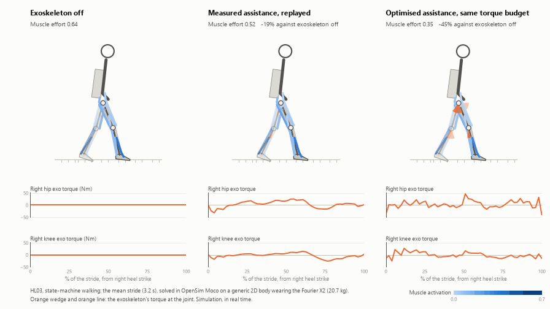

# AI-Driven Human–Exoskeleton Digital Twin

Recordings of 19 people walking in a Fourier X2 hip-and-knee exoskeleton (the ExoGait Benchmark),
AI models that predict the exoskeleton's torque from them, and an OpenSim Moco model that wears the
same exoskeleton, reproduces each person's walking, and is used to compare assistance: switched
off, as measured, as the AI predicts it, and optimised.



*One participant's mean stride, solved three ways. Muscle colour is activation; the orange wedges
are the exoskeleton's torque. Simulation.*

**New here?** [`ONBOARDING.md`](ONBOARDING.md): setup, reading order, rules.
**The plan and where it stands:** [`PROJECT_GUIDE.md`](PROJECT_GUIDE.md).
**The task lists:** [`docs/KURIAN_TASKS.md`](docs/KURIAN_TASKS.md), [`docs/JASITH_TASKS.md`](docs/JASITH_TASKS.md).

---

## Status (2026-11-11)

| Part | Code | State |
|---|---|---|
| Preprocessing and splits | `preprocess.py`, `split.py` | **Done**, all 19: 5,964 strides, whole-block train/val/test |
| Torque models | `evaluate.py`, `lstm.py` | **Built.** Phase mean, ridge, random forest, bagged trees, LSTM. Scored on the validation blocks; the test blocks are being scored |
| The twin | `x2model.py`, `track.py` | **Reproduces walking** for all 19 in both controller modes (hip 0.6°, knee 0.4° median error), on a generic body |
| Assistance in simulation | `assist.py` | **First result:** an optimised torque with the measured torque's budget lowers simulated muscle effort by 34% (16 of 16 participants). The AI-torque case is built, not yet run |
| Statistics | `stats.py` | Scripted for H1–H4; final numbers follow the test pass |
| EMG | — | **Blocked:** not in the public dataset |

Reports for the faculty are in [`docs/reports/`](docs/reports/). Every number and how it was
obtained: [`notes/observations.md`](notes/observations.md).

## Layout

```
src/exogait/   the project: one file per job, each with a self-check
docs/          task lists, data guide, allowed model inputs, reports
notes/         running log: observations, decisions, papers
models/        base OpenSim model, the stored start for solves, the participants' height and mass
figures/       figures and the film
data/          raw ExoGait CSVs and processed strides   (gitignored)
results/       solutions, predictions, tables           (gitignored)
```

`src/fatigue`, `src/mpc`, `src/musculoskeletal`, `src/allocation`, `src/jobs`, `src/activation`,
`configs/`, `deploy/` and `run_pipeline.sh` belong to the earlier plan and are parked
([`docs/guide_v3_fatigue_twin.md`](docs/guide_v3_fatigue_twin.md)).

## Setup

One environment, Python only (no MATLAB). OpenSim is not on PyPI, so it is a micromamba env:

```bash
micromamba create -n opensim -c opensim-org -c conda-forge python=3.11 opensim=4.6 "libblas=*=*openblas" numpy scipy pandas pyyaml matplotlib scikit-learn
```

```bash
micromamba run -n opensim python -m pip install torch --index-url https://download.pytorch.org/whl/cu126
```

Use `.../whl/cpu` without an NVIDIA GPU. The traps (OpenBLAS not MKL, never conda-install
casadi) are in [`ONBOARDING.md`](ONBOARDING.md). The raw data is downloaded by hand from
[Dryad](https://datadryad.org/dataset/doi:10.5061/dryad.70rxwdc6j) into `data/raw/exogait/`.

## Run

From the repo root, each through `micromamba run -n opensim python -u`:

| Step | Command | Time |
|---|---|---|
| Raw-file checks | `src/exogait/checks.py AB68 HL03` | 1 min each |
| Strides | `src/exogait/preprocess.py all` | 80 s |
| Splits | `src/exogait/split.py` | 2 s |
| Baselines, validation | `src/exogait/evaluate.py all` | 2 min |
| Forests and LSTM, validation | `src/exogait/evaluate.py all --models rf,bag,lstm` | 3 h |
| Final scores, test blocks | `src/exogait/evaluate.py all --test --models phase_mean,ridge,rf,bag,lstm` | 5 h |
| Statistics and figures | `src/exogait/stats.py` | seconds |
| The X2 model | `src/exogait/x2model.py` | 10 s |
| One tracking solve | `src/exogait/track.py HL03 SM_WALKING` | 8 min |
| Assistance cases | `src/exogait/assist.py HL03 SM_WALKING` | 20 min |
| The film | `src/exogait/animate.py HL03 SM_WALKING` | 4 min |

Running a file with no arguments runs its self-check.

## Key documents

| File | What it is |
|---|---|
| [`PROJECT_GUIDE.md`](PROJECT_GUIDE.md) | The plan, objectives and hypotheses, limits |
| [`docs/KURIAN_TASKS.md`](docs/KURIAN_TASKS.md), [`docs/JASITH_TASKS.md`](docs/JASITH_TASKS.md) | Tasks, file formats, shared rules |
| [`docs/model_inputs.md`](docs/model_inputs.md) | What a torque model may see, and why |
| [`docs/reports/`](docs/reports/) | Progress reports and the messages sent with them |
| [`notes/`](notes/) | The running log. Read it when writing up |

## Reproducibility

Every results file records the git commit that produced it. Raw data is never edited. Do not
hand-edit `results/`: regenerate it.
