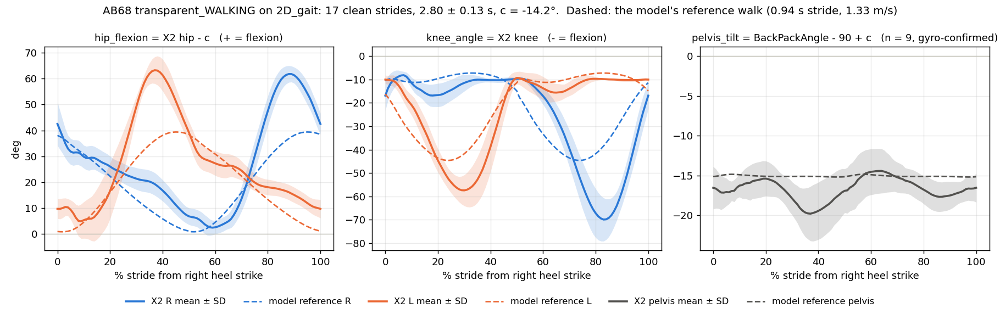
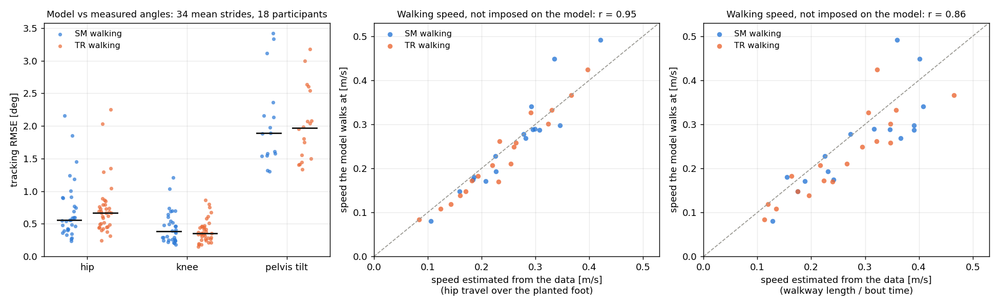
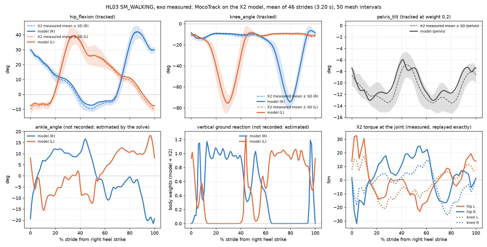
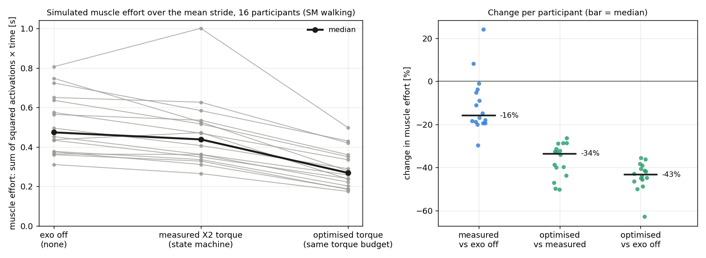

# AI-Driven Human–Exoskeleton Digital Twin: progress report

**10 November 2026 · Kurian Jose and Jasith Kadian · work on the mentor's ExoGait plan of 14 October**

## Summary

- **The simulation half of the plan now runs end to end on real data.** A musculoskeletal model
  wearing the Fourier X2 exoskeleton reproduces the walking of all 19 ExoGait participants, in
  both controller modes, from their recorded joint angles. All 38 solves converge. The median
  error is 0.6° at the hip and 0.4° at the knee.
- **The model walks at the right speed without being told it.** Speed is not an input. The speed
  the model settles on matches the speed estimated from the data (r = 0.95, 10% mean difference).
- **We found which torque column is the assistance.** The dataset has two torque columns. One is
  the motor's torque; the other is the torque delivered at the joint. About half of the motor
  torque goes into accelerating the motor's own rotor. This decides what the AI model should
  predict.
- **First test of H4: an optimised torque lowers simulated muscle effort by a third.** Against
  the exoskeleton switched off, the measured assistance lowers the model's muscle effort by 16%
  (median, 16 participants). An optimised hip and knee torque spending the same torque budget
  lowers it by a further 34%, in all 16 participants.
- **Not started: the AI torque-prediction half** (RO1, RO2). It waits on the preprocessing
  pipeline, which is our next piece of work.
- **Blocked: EMG-informed assistance** (RO5, H5). The public dataset has no EMG.
- Everything is in Python with OpenSim's Python interface, because the college has no MATLAB
  licence. Every file we produce (.osim, .sto, .csv) opens in MATLAB.

## Status against the plan

| Plan item | Status | Where it stands |
|---|---|---|
| Layer 1: ExoGait data | Done | 19 participants (5.5 GB) downloaded and checked, column by column |
| Layer 2: processing (RO1) | Not started in code | File formats, stride rules and split rules are fixed on paper |
| Layer 3A: AI torque prediction (RO2, H1–H3) | Not started | Waits on Layer 2 |
| Layer 3B: OpenSim model (RO3) | Done | X2 model built; angle mapping checked on all 19 participants |
| Layer 4: personalised twin state | Done for walking | Per-participant kinematics, device torque and offsets; body mass is generic (the dataset has none) |
| Layer 5: Moco optimal control (RO4) | Done for walking | 38 of 38 tracking solves converge; 34 pass every plausibility check |
| Layer 6: assist-as-needed, H4 | First result | Exo off, measured torque and optimised torque compared on 16 participants; the AI-predicted torque waits on RO2 |
| EMG-informed modulation (RO5, H5) | Blocked | No EMG in the public release |
| Evaluation at scale (RO6) | Not started | Cost measured: about 8 minutes per solve, 0.6 GB |

## Results

### 1. The dataset

ExoGait (Dryad) has 19 participants walking in a Fourier X2 (hip and knee motors on both legs)
in two controller modes: state machine (SM, assisting) and transparent (TR). It records joint
angles, velocities and torques at 333 Hz. It has **no EMG, no ground-reaction forces, no ankle
angle and no body measurements**, so the model has to estimate the last three.

**The two torque columns are different torques.** On all 19 participants, the motor torque
minus the strain-gauge torque is explained by the motor's rotor inertia plus friction (R² 0.82
to 0.98). The fitted inertia is 1.8–2.3 kg·m²; the published value for the X2 is 1.87. So the
gauge column is the torque that reaches the wearer, and it is the one the simulation replays.

### 2. The X2 model and the angle mapping

The 2D OpenSim gait model (18 muscles, foot–ground contact) carries the X2: 20.7 kg from the
published part masses, and hip and knee actuators limited to ±80 Nm. The X2 measures the hip
relative to its backpack, not the pelvis, so each participant gets one offset that splits the
reading into pelvis tilt and hip angle. Solid lines are one participant's measured angles on
the model; dashed lines are the model's own reference walk.

### 3. Reproducing the walking (MocoTrack)

For each participant and controller mode, the model tracks the mean stride's hip, knee and
pelvis angles with its own muscles and foot contact, while the exoskeleton's actuators replay
the measured joint torque. The ankle, the ground forces and the walking speed are not given:
the solve finds them.

| | Result (38 solves: 19 participants × 2 modes) |
|---|---|
| Converged | 38 of 38 |
| Pass every plausibility check | 34 (3 miss the tracking bound and 1 has a stuck torque sensor, see Limits) |
| Hip error (RMS), median [range] over the 34 | 0.6° [0.2–2.3] |
| Knee error | 0.4° [0.2–1.2] |
| Pelvis-tilt error | 1.9° [1.3–3.4] |
| Extra "reserve" torque the solver needed | under 0.03 Nm: the muscles and the X2 explain the motion |
| Walking speed, model vs data | r = 0.95, mean difference 10% (speed was not imposed) |
| Cost per solve | about 8 minutes on 4 threads, 0.6 GB |

*Each dot is one solve that passes every check (34 of 38). Left: tracking error per joint. Middle
and right: the speed the model walks at against two estimates of the real speed.*

One participant in detail (HL03, state-machine mode). Dashed lines and bands are the measured
mean ± SD; solid lines are the model. The bottom row is what the solve estimated or replayed.

### 4. What the exoskeleton delivers, against what the joints need

Summing the muscle, exoskeleton and reserve moments from each solution gives the net moment each
joint needs, which can be set against the torque the X2 delivered (medians over 36 to 38 legs,
RMS over the stride).

| | Net joint moment | X2 torque at the joint | Share of the net moment supplied by the X2 | Correlation |
|---|---|---|---|---|
| State machine, hip | 14.4 Nm | 10.3 Nm | 0.27 | 0.44 |
| State machine, knee | 11.7 Nm | 7.1 Nm | 0.19 | 0.26 |
| Transparent, hip | 16.3 Nm | 13.8 Nm | 0.09 | 0.25 |
| Transparent, knee | 14.0 Nm | 8.8 Nm | 0.12 | 0.22 |

In state-machine mode the X2's torque follows what the joint needs and supplies about a quarter
of it at the hip. In transparent mode the X2 delivers *more* torque at the hip but it follows
the joint's need less, and the model's muscles end up opposing part of it. It does carry the
device: against the X2 switched off, the transparent-mode torque lowers the model's effort by
34% (median, 14 participants). So transparent-mode torque looks like the device carrying
itself, not assistance in step with the gait, and we keep it out of the H4 test.

### 5. Optimised assistance on the same torque budget (H4, first result)

The same stride is solved with three exoskeleton torques: none (the X2 worn but switched off),
the measured state-machine torque, and a torque the optimiser chooses. The optimiser may not
spend more than the measured torque did: for each of the four motors, the integral of squared
torque over the stride is capped at the measured value. Without that cap it would win by
construction. Effort is the sum of squared muscle activations over the stride. The solver can
settle on different solutions from different starting points, so the first two cases were each
solved from two starts and the better solution kept.

| Muscle effort, 16 participants | Median change | Range | Lower in |
|---|---|---|---|
| Measured torque vs exoskeleton off | −16% | −30% to +24% | 14 of 16 |
| Optimised vs measured torque | −34% | −50% to −26% | 16 of 16 |
| Optimised torque vs exoskeleton off | −43% | −63% to −36% | 16 of 16 |

- Hip and knee are tracked within 2.3° in every case, inside the X2's ±80 Nm limit.
- The measured torque does not help every participant: it raises the model's effort in 2 of 16.
- The optimised torque is about twice as abrupt as the measured one. The gain does not come
  from that: filtered until it is as smooth as the measured torque, on the same budget, it still
  lowers effort by 25% and 36% in the two participants we tested.
- Three participants are left out: two whose measured-torque solve misses the tracking bound,
  and one with a stuck torque sensor.

## Limits of these results

- **Generic body.** The model is a 2D sagittal model of generic size (62 kg plus the 20.7 kg
  X2). The dataset gives no body measurements, so absolute effort and joint moments are generic.
  Differences between cases on the same stride mean more than absolute values.
- **Nothing to validate the ground forces or the ankle against.** Both are estimated.
- **Mean strides, walking only.** Single strides, ramps and stairs come next. Stairs go past the
  knee angles this 2D model's muscles are built for.
- **The hip–pelvis split borrows a pelvis tilt** from the model's reference walk. The three
  solves that miss the tracking bound are one participant whose backpack reads very differently
  (HL05, both modes) and one that misses by 0.1° (HL01).
- **The delivered-torque column carries a constant offset** of a few Nm that the data cannot
  separate from friction. One channel is stuck outright (AB82's left knee reads a constant
  −12 Nm in state-machine mode), so that solve is excluded.
- **The H4 result is a first one.** It is one mean stride per participant. "Exoskeleton off" is
  an X2 with no friction, which flatters it. The optimised torque has no rate limit yet.
- **Solver noise.** The same problem can converge to different solutions from different starts.
  In five repeat solves, effort agreed within 6% in three, and doubled in one. A second start
  for each case repaired that one, changed two of sixteen measured-torque solves by more than
  10%, and left the medians where they were (−33.0% became −33.6%). A full multi-start comes
  before any of these effort numbers is final. The tracking results barely move.
- **Simulated effort is not measured effort.** It is the sum of squared activations of a generic
  muscle set, and nothing here has been checked against a participant's metabolic cost or EMG.

## What we need

1. **EMG data, or confirmation that it is not available.** The Dryad release has none, although
   its README mentions it. Without it RO5 and H5 cannot be tested. We propose to report them as
   not testable if none arrives by 1 December.
2. **DGX access for the full evaluation (RO6).** At the planned scope it is about 5,000 solves:
   about a week on the laptop.
3. **Decisions on five points.** Each has a default we will proceed on otherwise:
    - which torque the AI model predicts (default: both columns, reported separately; if one,
      the delivered torque);
    - the H4 baseline and budget (default: as in section 5);
    - stairs in OpenSim, or only in the AI models (default: AI models only);
    - participants' body mass and height, if the authors' papers or you have them;
    - whether the registered title must change, since it says "MATLAB–OpenSim Moco".

## Next steps

- Build the preprocessing pipeline, the splits and the baseline models (RO1); then the
  random-forest and LSTM torque models with the H1–H3 comparisons (RO2).
- Feed the AI-predicted torque into the same simulation as a fourth case (RO4).
- Move from mean strides to single strides, and add ramps.
- Solve every case from several starts and keep the best, and limit the optimised torque's
  rate, so the effort numbers can be called final.
- Run the full evaluation (RO6) on the DGX.

*Code, notes and every number here: github.com/KurianJose7586/opensim-exo-fatigue (branch
`k5-track`). The results are regenerated by `src/exogait/track.py` and `src/exogait/assist.py`.*
