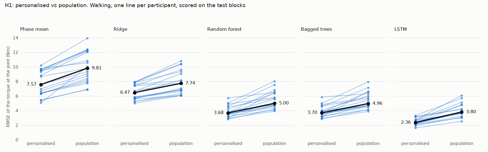
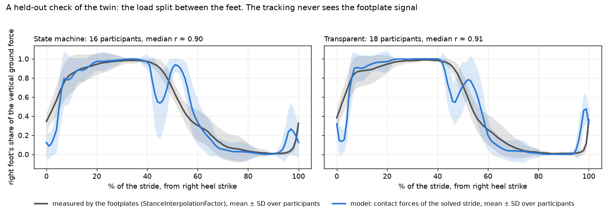

# AI-Driven Human–Exoskeleton Digital Twin: progress report 2

**11 November 2026 · Kurian Jose and Jasith Kadian · work on the mentor's ExoGait plan of 14 October**

This follows the report of 10 November, which covered the simulation half. The AI half is now done
too, and the two are joined.

## Summary

- **The preprocessing pipeline is built and run on all 19 participants (RO1).** 5,964 clean
  strides, each on 101 points, with a log of every stride that was dropped and why.
- **The torque models are trained and scored on held-out data (RO2).** A personalised LSTM
  predicts the torque the exoskeleton delivers at the joint to 2.4 Nm in walking (R² 0.97 at the
  hip, 0.94 at the knee). For a person it has never seen, the error is 4.0 Nm.
- **H1, H2 and H3 are supported.** Personalised models beat population models in all 19
  participants. Gait phase and locomotion mode both help, but only a little once the model is strong.
- **A finding outside the plan: joint acceleration is the input that matters for the motor
  torque.** It follows from last week's result that half the motor torque accelerates the motor's
  own rotor. Adding it nearly halves a linear model's error.
- **The AI torque works in the simulation (RO4).** Replayed in the musculoskeletal model in place
  of the measured torque, the LSTM's torque gives the same muscle effort (−1.4%, not significant).
- **A new check of the simulation against a measurement it never saw.** The exoskeleton's
  footplates record how the load is split between the feet. The model reproduces that split (r =
  0.90), and the comparison shows where its foot contact is wrong.
- **Every participant's height and weight are published** in the dataset's paper, which we had
  missed. The model body is still generic; scaling it is the next step.
- **EMG (RO5, H5) is still blocked.** The paper says EMG was recorded for five participants; it
  was not released. We wrote to the authors on 11 November.

## Status against the plan

| Plan item | Status | Where it stands |
|---|---|---|
| Layer 1: ExoGait data | Done | 19 participants checked, column by column |
| Layer 2: processing (RO1) | **Done** | Strides, stride features, exclusion log, whole-block train/validation/test splits, a leakage check |
| Layer 3A: AI torque prediction (RO2, H1–H3) | **Done** | Five models, two schemes, four input sets, two torques; scored once on the test blocks |
| Layer 3B: OpenSim model (RO3) | Done | X2 model; angle mapping checked on all 19 |
| Layer 4: personalised twin state | Done for walking | Generic body; height and mass now known for all 19 |
| Layer 5: Moco optimal control | Done for walking | 38 of 38 tracking solves converge; load split checked against the footplates |
| Layer 6: assistance, H4 (RO4) | **Done on mean strides** | Exo off, measured, AI-predicted and optimised torque compared |
| EMG-informed modulation (RO5, H5) | Blocked | Authors asked for the EMG of five participants |
| Evaluation at scale (RO6) | Partly | Prediction and mean strides done; single strides and ramps not started |

## Results

### 1. Preprocessing (RO1)

Each recording is cut into strides at the heel strikes the dataset marks, and each stride is
resampled to 101 points. Of 9,697 strides detected, 5,964 are kept. The rest cross into a turn or
a transition (2,237), are marked incomplete by the dataset itself (1,399), have an outlier
duration (75) or have gaps in sampling (22). Data is split by whole passes, never by random
strides, because neighbouring strides are near copies of each other.

Two faults in the data were found on the way. One participant's left-knee torque sensor is stuck
at a constant value for a third of their session. In five files the clock restarts and runs over
the same seconds twice.

### 2. Torque prediction (RO2)

Five models were compared: the average torque at each point of the stride ("phase mean"), ridge
regression, a random forest, bagged trees and an LSTM. Each was trained two ways: on the
participant's own earlier passes (personalised), and on the other 18 participants only
(population). All were scored on passes held out until the end.

Error in walking, in Nm, for the torque delivered at the joint:

| Model | Personalised | Population (unseen person) |
|---|---|---|
| Phase mean | 7.7 | 9.9 |
| Ridge | 6.5 | 7.9 |
| Random forest | 3.8 | 5.5 |
| LSTM | **2.4** | **4.0** |

The torque itself ranges over roughly ±40 Nm, so the personalised LSTM's error is about 3% of the
range. On ramps it is 3.0 Nm and on stairs 3.0 to 4.0 Nm. The motor's torque is harder to predict
(4.8 Nm personalised).

### 3. The three prediction hypotheses

*Each line is one participant. Personalised is lower for every participant in every model.*

| Hypothesis | Test | Result |
|---|---|---|
| H1: personalised beats population | LSTM, walking | 2.36 vs 3.80 Nm; 19 of 19 participants; p = 0.000004 |
| H2: gait phase helps | Random forest, walking | 3.68 vs 4.02 Nm without it; 19 of 19; p = 0.000004 |
| H3: locomotion mode helps | LSTM, all five modes | 2.81 vs 2.95 Nm without it; 18 of 19; p = 0.000008 |

All three hold. H2 and H3 are small for the strong models: a forest or an LSTM that sees both
legs' angles, their velocities and the foot-load signal can work out the phase and the mode for
itself. For the simple phase-mean model, phase is worth 4 Nm.

### 4. Joint acceleration

The first report showed that the motor's torque is the joint's torque plus what it takes to accelerate
the motor's own rotor. So a model that sees only angle and velocity at one instant cannot predict
the motor torque. Adding the acceleration (computed from the recorded velocity, so nothing new is
measured) takes ridge's walking error on the motor torque from 16.0 to 9.2 Nm and the random
forest's from 9.9 to 6.1 Nm, in all 19 participants. The LSTM gains least (5.3 to 4.9 Nm),
because it already sees how the velocity changes along the stride.

### 5. The AI torque in the simulation (RO4)

The LSTM's predicted torque for each participant's held-out strides was averaged and replayed in
the musculoskeletal model in place of the measured torque. The predicted average is 1.2 Nm off
the measured one. The model's muscle effort with it differs from the effort with the measured
torque by −1.4% (median of 15 participants, range −4.2% to +5.4%, not significant). One
participant's solve missed our accuracy check and is left out.

So the four assistance cases now stand side by side: exoskeleton off, measured, AI-predicted, and
optimised. The optimised torque still lowers effort by 34% against the measured one at the same
torque budget (16 of 16).

### 6. A check of the simulation against the footplates

The dataset has no ground reaction forces, which is the usual way to check a walking simulation.
But one of its columns turns out to be the share of the body's weight on one foot, measured by
force sensors in the exoskeleton's footplates. The simulation is never shown this signal, so it
is a fair test of the forces the model invents under its feet.

The model follows it (r = 0.90, median of 34 solves). It gets both single-support phases right.
It gets the hand-over between the feet wrong: the real load moves across smoothly, while the
model's incoming foot takes the load, gives it back and takes it again. That is a known weakness
of simple foot-contact models, now measured for this one.

## Limits

- **A generic body.** One 62 kg model for 19 people of 47 to 90 kg. Muscle effort is a model
  quantity, not checked against oxygen use or EMG.
- **Offline models.** Every torque model works on whole strides, which needs the next heel strike.
  They are not yet usable in a live controller.
- **Same-session test data.** The held-out passes come from the same session as the training
  passes, not another day.
- **Mean strides, walking only,** in the simulation. Ramps and stairs are in the prediction
  results but not in the simulation.
- **The solver's answer depends on its starting point.** The measured, AI and exo-off cases were
  each solved from two starts; a wider search is still to do.

## What we need

1. **A decision on EMG.** If the authors do not release it by 1 December, we propose to test H5
   on the model's own muscle activity instead, stated as such, and to report H5 on real EMG as
   not testable.
2. **DGX time** for the full evaluation on single strides: about 5,000 simulations.
3. **Your view on the two torques.** We predict both and replay the torque at the joint. If only
   one is wanted, we propose that one.

## Next

1. Scale the model to each participant's height and weight, and solve the walking again.
2. Single strides and ramps in the simulation.
3. The write-up of methods and results.
